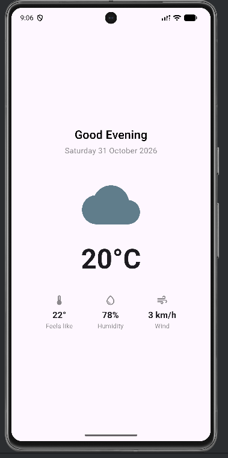
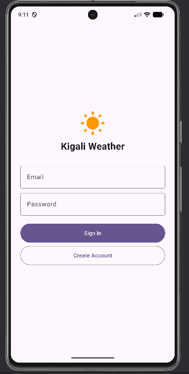
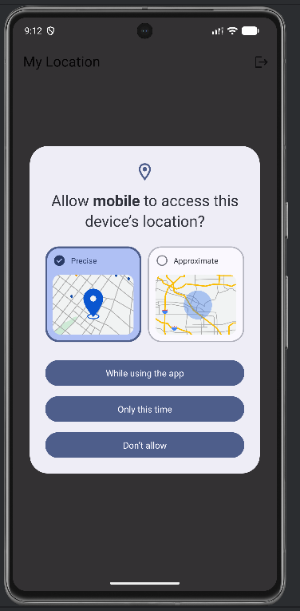
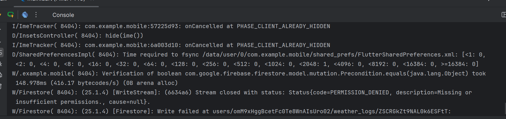
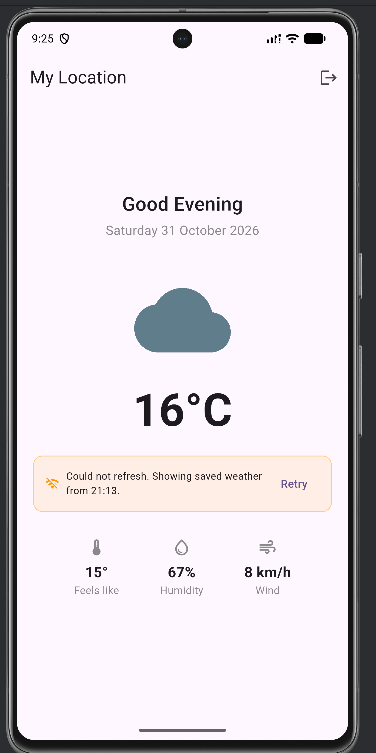

# Weather App

A Flutter weather app that shows live weather for your current location using the Open-Meteo API,
with full offline support via a date-stamped local cache powered by `shared_preferences`.

## Features
- Detects your current GPS location using `geolocator`, so the weather is always for wherever
  you are — not just Kigali.
- Fetches live temperature, feels-like, humidity and wind speed from the Open-Meteo API,
  with a day/night and condition-based icon.
- The last weather fetched is cached locally with `shared_preferences`, including the exact
  date and time it was saved. On the next launch — even with no internet — the screen shows
  that saved weather immediately with a timestamp ("Saved at 14:32 on Mon 9 June") instead
  of a blank loading state.
- If a background refresh fails (no internet), the app keeps showing the cached weather
  with an offline notice showing the saved date/time, and a Retry button.
- If there is no cached weather yet and the first load fails, a full error screen with
  a Retry button is shown.
- Pull to refresh re-fetches the weather manually.

## Screenshots






## Project structure
```
lib/
  core/constants.dart                          # App-wide constants
  data/models/weather_model.dart               # Weather model + Open-Meteo API fetch
  data/weather_store.dart                       # shared_preferences cache (save/load + timestamp)
  presentation/screens/weather_home_screen.dart  # Main screen: loading, cached, live, offline, error
  presentation/screens/login_screen.dart       # Firebase Auth: sign-in / sign-up
  main.dart                                    # Firebase init + AuthGate
```
